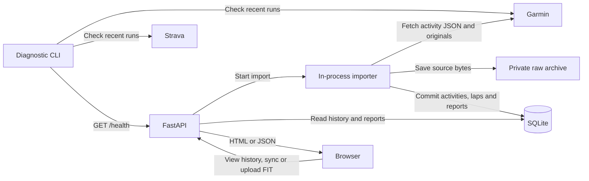

# Personal Garmin running history

* Author: khadar-mo
* Status: Proposed
* Date: 2026-11-16

## Problem

I want to open October 2026, see which runs make up the total, and check a surprising number against the activity in Garmin Connect. Today the Python CLI can request up to ten recent runs. It saves no training history, so I cannot answer that question when Garmin is offline.

## Goals

| Requirement | Outcome |
|---|---|
| REQ-1 | From a terminal I can verify Garmin or Strava access, or check the local API. One recognisable Garmin run agrees with Connect on ID, local start, distance and elapsed time. |
| REQ-2 | I can import my available runs from 1 June 2026 onwards, recover a run from a FIT file offline, and repeat either import without double counting. I can see exactly what was checked and what failed. |
| REQ-3 | I can reconcile a week and October 2026 with Garmin Connect and open the activities and recorded laps behind the totals. |

## Non-goals

Coaching or plan generation, health and recovery data, Strava history import, synthetic kilometre splits, routes on a map, multiple accounts, hosting and scheduled jobs.

## User journeys

### J-1: Check an API (REQ-1)

* Given: The dashboard is closed.
* When: I probe Garmin, Strava or the local app from the terminal.
* Then: I see the selected provider's recent runs or a valid empty result. The local probe tells me whether FastAPI can read SQLite. Neither check imports runs.

### J-2: Recover access (REQ-1)

* Given: A credential is missing, expired or rejected.
* When: I check the connection.
* Then: The command exits nonzero, names the failed step and tells me how to reconnect without exposing the credential.

### J-3: Sync history (REQ-2)

* Given: I want an initial backfill, a routine sync or a specific month.
* When: I select **Sync Garmin** and optionally enter dates.
* Then: I can open the saved report, see which dates were checked and inspect the runs. Repeating the sync updates existing activities.

### J-4: Import an offline FIT (REQ-2)

* Given: I have exported FIT files and Garmin is unavailable.
* When: I choose the files on the Imports page.
* Then: New runs appear. Exact duplicates point to an existing run. For an uncertain match I can link the file to a run or confirm it is separate.

### J-5: Recover an incomplete import (REQ-2)

* Given: I enter invalid dates, select a damaged file or lose connectivity mid-import.
* When: I submit the import and inspect the result.
* Then: Invalid dates are rejected immediately. A saved report identifies failed files, IDs or pages. Good runs survive and I can retry.

### J-6: Check a training period (REQ-3)

* Given: I have imported runs.
* When: I choose a week or month and open one of its runs.
* Then: I can trace the total to the contributing activities and recorded laps. Missing values and incomplete periods are labelled, including offline.

## Technical design

One FastAPI process serves HTML and JSON at `127.0.0.1:8001`. Both views use the same import and query functions. Opening a view reads local data. The port leaves the existing Strava sign-in callback on 8000 available. [FastAPI templates](https://fastapi.tiangolo.com/advanced/templates/)

**Starting point.** `runs.py` already exchanges a Garmin key for a bearer token, reads one page of runs and formats elapsed time. Its Strava path handles authorisation and refresh. The README and the earlier terminal connection spec describe these commands. The repo has no `REQUIREMENTS.md` or `ARCHITECTURE.md`. REQ-1 through REQ-3 are local to this ticket. The runner verified the provider CLI against Connect in PR #8.

### Interfaces

| Interface | Contract |
|---|---|
| `python3 runs.py garmin --limit 1` and `python3 runs.py strava --limit 1` | Contact only the selected provider, even with FastAPI stopped. Keep the 1–10 limit and Strava `--connect` setup. Print ID/link, activity-local start, km and elapsed time. A valid response, including an empty list, exits 0. |
| `python3 runs.py health` → `GET /health` | Return 200 and `{"status":"ok"}` when SQLite is readable, including when empty. Return 503 for a database failure. A connection error, timeout or non-200 exits the CLI nonzero. No provider request. |
| `POST /api/imports/garmin` | Accept `{}` for normal sync or an inclusive date pair, e.g. `{"from":"2026-10-01","to":"2026-10-31"}`. Malformed, one-sided or reversed bounds return 422 before work starts. |
| `POST /api/imports/fit` | Accept one or more uploads in multipart field `files`. Archive uploaded bytes before the request ends. Report corrupt or unsupported files individually. |
| `GET /api/imports` and `GET /api/imports/{id}` | Show attempts newest first and the report for one attempt. Show time and outcome of the latest attempt. Each issue names the activity, file or unread range, failed step and recovery action. |
| `POST /api/imports/{id}/issues/{issue_id}/resolve` | Accept `link` with a local activity ID, `keep_separate`, or `set_local_date` with a confirmed date for an undated FIT. Save the choice so retries honour it. |
| `GET /api/history` and `GET /api/activities/{id}` | History accepts the same date pair and defaults to the current month. Return activity IDs, coverage, weekly/monthly totals, counts and longest run. Detail uses a stable local ID and includes Garmin ID/link, metrics, ordered laps, sources and warnings. Unknown IDs return 404. |

The **History** page opens **Activity detail** from any row. **Imports** holds the range, sync, upload and resolution controls. Both import endpoints return 202 with an import ID and report URL. One import runs in the FastAPI process at a time. A second submission returns 409 with the active ID. Refreshing a page reads its state. After a restart an unfinished attempt is marked interrupted and its range or files can be resubmitted. [FastAPI background tasks](https://fastapi.tiangolo.com/tutorial/background-tasks/)

### Import, identity and coverage

1. **Find available runs.** First normal sync covers 1 June 2026 through today. Page using Garmin's date bounds and offset, advancing by the number returned until an empty page. A repeated page with no progress is a partial scan. Fetch a boundary day on either side and enforce the requested dates on the recorded local start. Include running and its trail, treadmill, track and virtual subtypes. Check the parent filter against the reference month and query omitted running subtypes if needed. [Garmin activity search and downloads](https://github.com/garmin/connect-personal-api-python#endpoint-wrappers)
2. **Keep the evidence.** For each new ID retain the original activity JSON, obtain the detail response and request the original file. Archive changed JSON and original ZIP/FIT bytes unchanged, keyed by SHA-256. Reuse a good archived original on repeat sync. Hash the FIT member itself so the same file in a ZIP and on disk has one identity. Keep failed inputs when bytes exist. Use Garmin's decoder for single-session running FITs. Report multisport files, other sports and decode failures. [Garmin FIT Python SDK](https://github.com/garmin/fit-python-sdk)
3. **Resolve identity before counting.** Update by unique Garmin ID. Link a manual and downloaded run by exact FIT hash or a unique complete tuple of manufacturer, product, device serial, creation time and UTC session start. Conflicting IDs need review. With no exact match, UTC starts within 60 seconds prompt review only. Hold the incoming candidate out of totals until resolved. Otherwise a valid distinct FIT gets a local ID. In either import order an exact match keeps the original local ID. The same SHA-256 cannot create a second run, even through manual resolution.
4. **Save and retry.** Write raw bytes atomically, then commit the activity, source links and replacement laps in one SQLite transaction. Keep the last good row on failure. Refresh details when the list record changes or details were missing. An explicit range recheck refreshes details for every returned ID, including older edits. A missing original allows a valid summary to count with a warning. Retry unresolved fetch failures on the next sync, even outside its date window. Absence from a search never deletes a run.
5. **Track coverage.** After backfill, start normal sync 13 days before the last fully covered end date, floored at 1 June. This revisits 14 dates and catches up through today. An older edit is found by rechecking its date range. Advance the baseline only for contiguous dates fully enumerated from 1 June with all required metadata imported. An October-only test cannot skip June–September. A failed page or missing required metadata marks the range partial.
6. **Report outcomes.** Record requested/scanned dates, earliest and latest saved run, unique IDs found, inserted/updated/unchanged counts, exclusions, unresolved matches, failures and original files available/requested. Distinguish “no runs returned” on a fully checked empty range from “coverage incomplete”. The report exposes saved Garmin IDs. The runner compares those with the Connect list and notes missing or extra IDs.

On a rejected Garmin bearer token, obtain a new token and retry once. A persistent rejection prompts key replacement. Report a 403 as denied access and a 429 with the retry time if supplied. Network and unexpected-response errors name the failed step. [Garmin Personal API authentication](https://developer.garmin.com/gc-developer-program/personal/personal-faq)

### Stored data and calculations

| Record | Fields and rules |
|---|---|
| Activity | Stable local ID, nullable unique Garmin ID, sport/subtype, name, UTC start, recorded local start/date, distance in metres, elapsed/timer/moving seconds, average HR, GPS availability and selected metric sources. Optional fields are nullable. |
| Lap or recorded split | Local activity ID, source kind, sequence, actual distance and separate durations. Unique per activity, kind and sequence. Keep partial laps. Distinguish recorded laps from any separate source splits. |
| Archived source | Checksum, format, local archive reference, acquisition time, source filename/ID, FIT identity when complete, and activity link or pending state. Saved bytes allow offline reprocessing. |
| Import and issues | Requested range, mode, state, counts, failed IDs/files/pages and resolution. States are `running`, `complete`, `partial`, `failed` and `interrupted`. Optional-source warnings can coexist with complete metadata coverage. |

- **Dates.** Group the whole run by the local date shown on its Garmin activity. Use Monday–Sunday weeks and calendar months. Keep UTC for identity and ordering. Use Europe/London only to determine today's date for default ranges. For a manual FIT, derive its local start date only when the file supplies sufficient offset information. If unknown, show it as undated until linked to Garmin or the runner supplies its date. A local 1 November run belongs in November even if its UTC start falls in October.
- **Metrics.** Reuse the CLI's list fields `activityId`, `startTimeLocal`, `distance` (metres) and `elapsedDuration` (seconds). Prefer valid Garmin detail over list summary, then fill gaps from FIT. Keep the chosen source. FIT sessions and laps provide `total_distance`, `total_timer_time` and `total_elapsed_time`. Timer time follows the watch timer, elapsed includes pauses, and moving time requires an explicit moving value. Verify any ambiguous API duration against a paused run before using it. Preserve edited Garmin headlines and flag lap discrepancies. Missing HR, GPS, laps or duration shows “Not available”, with the download warning if relevant. [Garmin FIT activity format](https://developer.garmin.com/fit/file-types/activity)
- **Totals and pace.** Sum valid metres and seconds before rounding. Show km to two decimals and mm:ss/km to the nearest second. Timer pace is timer seconds divided by km. Label moving pace separately when available. A missing or nonpositive input gives no pace. Reject nonfinite or negative measurements. Count confirmed runs even when a metric is missing, label its known subtotal and give the missing count. Rank longest by unrounded distance and show ties.

## Decisions

| Decision | Chosen | Instead of | Why | Cost |
|---|---|---|---|---|
| First deliverable | One real run, archived, saved and viewable offline | Build the full backfill first | A single comparison exposes wrong date, time or identity assumptions early. | The first demo covers one run. |
| App and CLI | FastAPI serves HTML and JSON. The CLI probes providers and local health. | Separate dashboard server or a CLI that owns imports | One app to start and one import path to maintain. | Imports require FastAPI to be running. |
| Persistence | SQLite plus immutable local originals | Fetch history from Garmin on each view | I can reproduce a number offline and retry a failed import. | I look after one database and its archive. |
| Calendar and duplicates | Use Garmin's recorded date and review uncertain matches | Group every run in London time or merge by similar distance | The displayed period and the identity of each run can be checked against Connect. | Some FIT-only records need one confirmation. |

## Risks and rollout

1. **One run.** Run the existing Garmin probe, note one known ID, and sync that run's date using FastAPI. Open its stored detail, restart offline and open it again. Capture the source-field mapping for a synthetic test fixture. A real account comparison signs off connection access.
2. **One month.** Import 1–31 October 2026, including original files, laps, manual FIT recovery and retry. Compare IDs with Connect, repeat the import, then demonstrate the monthly and weekly totals. Record any missing or extra ID. Use the account holder's private comparison to sign off October.
3. **Available history.** Use the same importer from 1 June 2026 through today. Check gaps and repeat normal sync. Record expected and actual results privately with range, filters and any unresolved differences.

Start with an empty database. Before replay or schema changes, back up the database and archive together. Stop the app and restore the pair if rollback is needed. Bind to loopback, accept browser writes only from the app's own origin, and keep keys, tokens, HR/GPS files and personal acceptance evidence out of Git and logs.

The provider CLI is tracked. Include this spec alongside the source and keep other private documents outside Git. Document the start command, pin dependencies and run `python3 -m pytest` with synthetic FIT/JSON, stubbed HTTP, temporary storage and FastAPI route checks.

## Acceptance

| ID | Done when | Proves | How to check |
|---|---|---|---|
| AC-1 | One real Garmin ID, recorded start, km at the same display precision and elapsed time within one second match Connect. | J-1, REQ-1 | With FastAPI stopped, run the Garmin probe and open the returned link. Record the comparison. An empty success cannot pass this check. |
| AC-2 | Provider and local probes report independent status and disclose no credentials. | J-1, J-2 | An empty provider list exits 0. A missing key, persistent 401, 403, timeout or 429 exits nonzero with a recovery action. Probe Strava with Garmin unavailable. Check local health with the server stopped, running with an empty database, and running with unreadable storage. |
| AC-3 | The same saved run opens via HTML and JSON with upstream access disabled. | J-3, J-6 | Sync its date, restart the app offline and compare the ID and metrics on both views. Refreshing makes no provider call. |
| AC-4 | A paginated range imports every expected ID once and edits update the correct row. | J-3 | Supply more than ten runs across pages, a running subtype, an excluded sport and a repeated ID. Resync after changing a distance. Compare IDs, counts, totals and original versions. |
| AC-5 | A failed page or activity is reported, and retry produces the same records as an uninterrupted import. | J-3, J-5 | Interrupt between pages and during an activity write. Check the previous good row and coverage. Try a second sync while the first is active. Retry after restart. A bounded October import followed by normal sync still covers June. |
| AC-6 | FIT works offline. Identical FIT bytes, including a FIT inside a downloaded ZIP, count once in either import order. | J-4 | Import a real FIT offline. Repeat with a renamed copy. Exercise API-first and FIT-first with fixtures. Present two similar but distinct runs, resolve the match and repeat. |
| AC-7 | Invalid dates write nothing. A corrupt file or unavailable original is named. Other valid runs remain visible. | J-4, J-5 | Submit a reversed range, a batch with one damaged FIT, a multisport FIT and a missing original. Check 422 versus per-item report entries and compare metadata/file coverage. |
| AC-8 | October's IDs, run count, longest run and unrounded-source total agree with Connect at matched precision. A full week agrees too. | J-3, J-6, REQ-2, REQ-3 | Compare 1–31 October and 19–25 October 2026 using the same running filters. Use Garmin's displayed aggregate at the same precision. Use the aggregate from Connect as the expected result. |
| AC-9 | Pauses, missing fields and recorded laps have the right labels and units. | J-6 | A 5,000 m fixture with 1,500 timer seconds and 1,800 elapsed seconds displays 5.00 km, 5:00/km timer pace, 25:00 timer and 30:00 elapsed. Omit moving time, HR and GPS. Compare a real run's ordered lap distances and times with Connect. |
| AC-10 | Periods, rounding and partial totals are reproducible. | J-4, J-6 | A local 1 November run with UTC date 31 October appears only in November. Check a daylight-saving weekend and an undated FIT. Two 1,004 m runs show 2.01 km in total. A third run with unknown distance gives three runs, a 2.01 km subtotal and one missing distance. |

## Open decisions

None.
